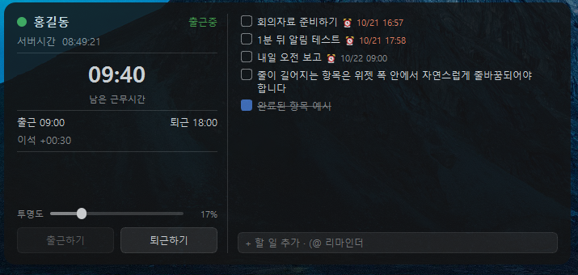

# PRD

- [PRD](#prd)
  - [미리알림 앱 계획](#미리알림-앱-계획)
    - [앱이름](#앱이름)
    - [앱 이미지](#앱-이미지)
    - [기술스택](#기술스택)
    - [FE](#fe)
    - [BE](#be)
    - [추가 문의(예정이므로 기능 구현만)](#추가-문의예정이므로-기능-구현만)
    - [참고 소스 경로](#참고-소스-경로)
    - [버전 규칙](#버전-규칙)
    - [코딩 규칙](#코딩-규칙)
      - [포매팅](#포매팅)

## 미리알림 앱 계획

- 개요 : 업무당 시간관리를 하고, 미리알림 서비스를 제공해 사용자가 다음 업무 계획을 짜기 좋게 한다.

### 앱이름

- Task알림
  - 내부 식별자(AppData 폴더명, 레지스트리 키 등)는 `TaskPin`
- 앱아이콘은 `ico/taskpin_icon_A_memo.svg` 임시 배정

### 앱 이미지

- 참고 앱 화면이므로 아래 FE 변경사항은 반영되어 있지 않음

### 기술스택

- Python 3.11.4 이상
- GUI 프레임워크 : PySide6
- 빌드도구 : nuitka
- DB : SQLite (Python 내장 `sqlite3`)
- 윈도우 전용
  - Mac은 추후 검토 : OS 의존 코드(자동 실행, 창 z-order, 저장 경로)는 한 모듈로 분리해 둠
  - nuitka는 교차 빌드가 안 되므로 Mac 빌드는 Mac에서 별도 진행

- 참고사항
  - api, js, mysql, css 등 사용할 줄 알고 있음

### FE

- 사내 서버 로그인 쪽 삭제
- UI만 구성
- 서버시간 -> 현재시간
- 남은 근무시간 -> 남은시간
- "출근" -> 시작
- "퇴근" -> 종료
- "출근하기"/"퇴근하기" 버튼은 불필요함
  1. [Task 등록] [Task 해제] 버튼으로 수정 (그 아래 투명도 슬라이드)
     - Task 등록 후 업무명은 가운데정렬 + 테두리로 강조 (클릭 없음)
  2. Task 등록을 하게되면 시작 --:-- -> 시작 09:30
     1. 시작시간 디폴트는 현재시간
     2. 사용자가 시간을 선택할 수 있어야함(15분단위)
     3. 종료 시간은 Task 시간 등록 때 몇시간을 할지 선택된 기준으로 작성
     4. 남은 시간이 종료가 된 이후에는 "+"로 수정
  3. 시간관리는 한 번에 한 업무(Task) 기준
- 우측 패널 TODO list는 기존 기능 그대로 유지
  - 계단(레벨): 드래그 앤 드롭으로 다른 todo 위에 올리면 그 todo의 하위 레벨로 (여러 단계 가능)
    - 상위를 완료하면 하위도 완료, 하위를 해제하면 상위도 해제
    - 상위를 삭제하면 하위는 한 단계 위로 올라감
- 앱이 이미 실행 중일 때 다시 실행하면 기존 앱의 위젯을 띄워 활성화 (트레이 아이콘 클릭과 같음)
- 이석관련 내용은 제거
- 출근중은 불필요
- 이름은 사용자가 더블클릭해서 수정 "홍길동" -> "김유신"
  - 더블클릭해서 수정할 수 있는 부분은 사용자 이름을 입력하는 곳 뿐
- 트레이 아이콘 우클릭 메뉴는 위젯 관련 내용만 남김
  - 남김 : 위젯 보이기/숨기기, 프로그램 종료
  - 제거 : 프로필, 현재 시간, 새로고침, 출근 상태/시간 정보, 출근하기/퇴근하기, WIMS 바로가기, 로그인 정보

### BE

- 배포: Nuitka standalone 빌드 + Inno Setup 사용자 단위 설치본(관리자 권한 불필요, onefile은 쓰지 않음)
- 앱관련 정보(기존 src/에 저장하는 것들은 appdata에 저장해야함)
- AppData : `%APPDATA%\TaskPin\`
  - `config.json` : 위젯 설정(위치·크기·투명도·모드 등), 사용자 이름
  - `taskpin.db` : SQLite — TODO, 정리된 완료 항목, Task 시간 등록 정보
- 할 일 완료 후 "완료 항목 정리"를 해도 삭제하지 않고 DB에 보관

### 추가 문의(예정이므로 기능 구현만)

- 다른 앱들처럼 설정이 필요한 부분 체크(ex: 폰트 / 색상 / 테마)

### 참고 소스 경로

- `C:\Users\kh.Cha\Documents\MyProject\Priv_WimsClockManager\`

### 버전 규칙

- 시멘틱 버저닝에 따름

### 코딩 규칙

#### 포매팅

- Ruff를 따름
